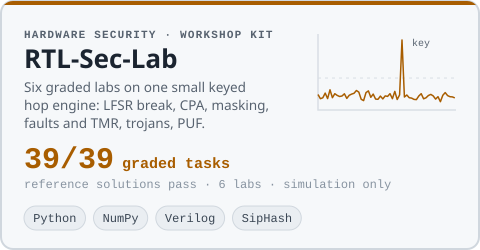
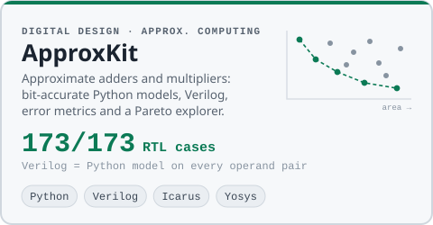
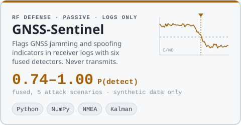

<a href="https://www.linkedin.com/in/kavinkk-vlsi-embedded">
  <picture>
    <source media="(prefers-color-scheme: dark)" srcset="assets/banner-dark.svg">
    
  </picture>
</a>

### Hi, I'm Kavin.

I'm an electronics engineer (B.Tech Electronics Engineering, VLSI, at Rashtriya Raksha University) who
works where firmware, digital logic and security meet: pulling entropy out of a noisy diode, getting a
hazard alert through an RTOS in microseconds, breaking a weak hop schedule and replacing it in Verilog,
and checking approximate arithmetic bit for bit against its model.

I care about measured results and about saying what kind of result each one is. Two projects below ran
on real hardware (Haptic-Sense, PhyRand). The rest are simulation, RTL and host-tested code, and are
labelled that way. Where a number appears, the repository says how it was produced and what has not
been measured yet.

**Open to embedded firmware, RTOS, digital design and hardware-security roles.**
[Connect on LinkedIn](https://www.linkedin.com/in/kavinkk-vlsi-embedded)

## What I build

| Area | What that has meant so far |
|---|---|
| **Hardware security** | A true random number generator built from Zener-diode breakdown noise with on-chip Von Neumann debiasing; a keyed SipHash-2-4 hop engine in Verilog checked against a Python model and with SymbiYosys; a workshop kit covering state recovery, correlation power analysis, masking, fault injection and PUFs on simulated models. |
| **RF resilience and defense** | Frequency-hopping link simulators with attacker models, a benchmark that scores hop schedules against those attackers, and passive, receive-only detectors for GNSS interference and drone links. All simulation so far; none of it transmits. |
| **Real-time firmware** | A four-task µT-Kernel 3.0 application on a Cortex-M55 with preemption latency measured two ways (logic analyzer and in-firmware cycle counter); bare-metal STM32F4 work with UART parsing, FatFS over SPI and an OLED; C99 protocol references with no dynamic allocation, tested under sanitizers and fuzzing on the host. |
| **Digital design and approximate computing** | Approximate adders and multipliers as bit-accurate Python models plus Verilog, compared exhaustively in Icarus Verilog and synthesised with Yosys; approximate SAD datapaths for video motion estimation; an int8 inference datapath with approximate multipliers. |
| **Edge ML on MCUs** | A small INT8 fully-connected model trained in Edge Impulse and run on the STM32N6 Neural-ART NPU, backed by a deterministic safety rule. |
| **Tooling** | A single-file browser waveform viewer for VCD dumps, serial capture and analysis scripts, and a local-LLM shell assistant. |

## Featured projects

  <a href="https://github.com/Kavin-Re/Haptic-Sense">
    <picture>
      <source media="(prefers-color-scheme: dark)" srcset="assets/card-haptic-sense-dark.svg">
      
    </picture>
  </a>
  <a href="https://github.com/Kavin-Re/phyrand">
    <picture>
      <source media="(prefers-color-scheme: dark)" srcset="assets/card-phyrand-dark.svg">
      
    </picture>
  </a>

  <a href="https://github.com/Kavin-Re/FHSS-Link">
    <picture>
      <source media="(prefers-color-scheme: dark)" srcset="assets/card-fhss-link-dark.svg">
      
    </picture>
  </a>
  <a href="https://github.com/Kavin-Re/RTL-Sec-Lab">
    <picture>
      <source media="(prefers-color-scheme: dark)" srcset="assets/card-rtl-sec-lab-dark.svg">
      
    </picture>
  </a>

  <a href="https://github.com/Kavin-Re/ApproxKit">
    <picture>
      <source media="(prefers-color-scheme: dark)" srcset="assets/card-approxkit-dark.svg">
      
    </picture>
  </a>
  <a href="https://github.com/Kavin-Re/GNSS-Sentinel">
    <picture>
      <source media="(prefers-color-scheme: dark)" srcset="assets/card-gnss-sentinel-dark.svg">
      
    </picture>
  </a>

| Project | In one line | Honest status |
|---|---|---|
| [**Haptic-Sense**](https://github.com/Kavin-Re/Haptic-Sense) | Predictive obstacle-alert prototype for visually impaired users on an STM32N6570-DK running µT-Kernel 3.0. TRON Forum Programming Contest 2026, entry 34476. | **Hardware.** Worst-case preemption latency 3.375 µs (logic analyzer) and 4.19 µs (cycle counter, 30-minute soak). These time the task handoff, not sensor-to-motor latency. Benchtop prototype, urgency feedback only, no direction. |
| [**PhyRand**](https://github.com/Kavin-Re/phyrand) | Zener-noise TRNG on an STM32F401RE, with a FastAPI key authority and Fernet file vault. | **Hardware.** 7.9997 bits/byte measured with `ent`. NIST SP 800-22 is still pending, and the analog noise has not been characterised on an oscilloscope. |
| [**FHSS-Link**](https://github.com/Kavin-Re/FHSS-Link) | Frequency-hopping link study: link and attacker simulators, a keyed SipHash-2-4 hop engine in Verilog, and a C firmware reference. | **Simulation, RTL and host C.** An attacker model recovers a 16-bit LFSR hop schedule after 8 or 9 observed hops (exhaustive over all 65,535 seeds), while the keyed schedule stays at chance. Synthesis figures are Yosys estimates. Nothing has run on an ESP32 or any radio yet. |
| [**RTL-Sec-Lab**](https://github.com/Kavin-Re/RTL-Sec-Lab) | Three-hour hardware-security workshop kit: six labs with handouts, starters, graders and answer keys, built around a small keyed hop engine. | **Simulation only.** All 39 reference-solution tasks pass the graders. Leakage, fault, trojan and PUF behaviour are simple assumed models, and every handout says so. |
| [**ApproxKit**](https://github.com/Kavin-Re/ApproxKit) | Approximate adders and multipliers: bit-accurate Python models, error metrics, a Pareto design-space explorer and Verilog. | **Simulation and synthesis estimates.** 173 of 173 Verilog cases match the Python models on every operand pair (Icarus Verilog). Area numbers are Yosys + sky130 estimates without place and route, not silicon. |
| [**GNSS-Sentinel**](https://github.com/Kavin-Re/GNSS-Sentinel) | Passive toolkit that flags GNSS jamming and spoofing indicators from receiver logs (CSV or NMEA) with six fused detectors. It never transmits. | **Synthetic data only.** Fused detection probability is 1.00 for four attack scenarios and 0.74 for slow position drag, at about 1.1 false alerts per hour. A noisier test profile raises that to about 7 per hour. Not validated on a real receiver. |

## More projects

<table>
  <tr><th align="left">Theme</th><th align="left">Project</th><th align="left">What it is, and where it stands</th></tr>
  <tr>
    <td rowspan="2"><b>Hardware security &amp; RF defense</b></td>
    <td><a href="https://github.com/Kavin-Re/HopBench"><b>HopBench</b></a></td>
    <td>Benchmark that scores frequency-hop schedules against a suite of attackers (state recovery, n-gram, Berlekamp-Massey, jammers). Keyed schedules score 99.8 and the LFSR, LCG and xorshift schedules about 20 to 23 out of 100. Scores are relative to this attacker suite, not a security proof. Includes a browser game, "Break the Hop".</td>
  </tr>
  <tr>
    <td><a href="https://github.com/Kavin-Re/ADIS-Detector"><b>ADIS-Detector</b></a></td>
    <td>Receive-only drone-link detector: an Android app (RF Analyzer fork, GPL) with a Python DSP backend and a React field view, for a phone plus HackRF One. Simulation and unit tests only. Not yet tested on real hardware, and its thresholds are documented placeholders.</td>
  </tr>
  <tr>
    <td rowspan="2"><b>Embedded &amp; RTOS</b></td>
    <td><a href="https://github.com/Kavin-Re/UAV-DAQ"><b>UAV-DAQ</b></a></td>
    <td>STM32F401RE telemetry logger: parses a UART stream, logs CSV to SD with FatFS over SPI, shows values and rates of change on an OLED. Bench prototype fed by a replayed ArduPilot log; host-tested, and the SD-logging fix still awaits a hardware re-test. Not flight-tested.</td>
  </tr>
  <tr>
    <td><a href="https://github.com/Kavin-Re/LifeLine-Mesh"><b>LifeLine-Mesh</b></a></td>
    <td>Store-and-forward mesh protocol for short messages when infrastructure is down: specification, Python simulator and a C99 reference with no dynamic allocation. C and Python agree on 288,113 shared-vector checks. In simulation, custody transfer delivers 1.00 against 0.69 for flooding in the default scenario. No hardware or RF yet.</td>
  </tr>
  <tr>
    <td><b>Digital design &amp; approximate computing</b></td>
    <td><a href="https://github.com/Kavin-Re/PolarFire-VibMonitor"><b>PolarFire-VibMonitor</b></a></td>
    <td>Software model of a 32-channel vibration monitor: fixed-point feature extraction, an int8 MLP, approximate multipliers and a Verilog MAC-array skeleton. About 97 % accuracy on its own synthetic test set. The RTL testbench passes 325,161 checks against the Python model. No FPGA has been touched.</td>
  </tr>
  <tr>
    <td rowspan="2"><b>Tools</b></td>
    <td><a href="https://github.com/Kavin-Re/VCD-Studio"><b>VCD-Studio</b></a></td>
    <td>Single-file, offline waveform viewer for VCD dumps that runs in the browser, plus a stdlib Python script for per-signal toggle counts and a switching-activity proxy.</td>
  </tr>
  <tr>
    <td><a href="https://github.com/Kavin-Re/shell-sage"><b>shell-sage</b></a></td>
    <td>Python CLI that turns a plain-English request into a bash command using a local Ollama model, with a warning on risky commands.</td>
  </tr>
</table>

## Tech stack

<table>
  <tr><td><b>Languages</b></td><td>   </td></tr>
  <tr><td><b>MCUs &amp; boards</b></td><td> </td></tr>
  <tr><td><b>RTOS &amp; firmware</b></td><td>   </td></tr>
  <tr><td><b>RTL &amp; verification</b></td><td>    </td></tr>
  <tr><td><b>Buses &amp; peripherals</b></td><td>    </td></tr>
  <tr><td><b>Security &amp; crypto</b></td><td>    </td></tr>
  <tr><td><b>Edge ML</b></td><td>  </td></tr>
  <tr><td><b>Host side</b></td><td>     </td></tr>
</table>

## Currently

- Working toward NIST SP 800-22 validation of PhyRand's output, the open item in that repository.
- Taking FHSS-Link from host-only tests to its first run on ESP32 hardware, the open item in that repository.
- Writing up the approximate-SAD research from the NIT Delhi internship.
- Looking for a role in embedded systems, digital design or hardware security.

## Contact

- LinkedIn: [linkedin.com/in/kavinkk-vlsi-embedded](https://www.linkedin.com/in/kavinkk-vlsi-embedded)
- GitHub: open an issue on any repository above, and I will reply there.

<!--
Optional: live GitHub stats. These come from a third-party service (github-readme-stats), which can be
slow or rate-limited on its public instance. Remove the comment markers around this block to enable it.

  

-->

Banner and project cards are hand-written SVG, generated by <a href="tools/build_assets.py"><code>tools/build_assets.py</code></a>. No trackers, no external fonts.
