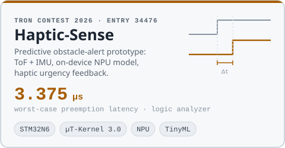
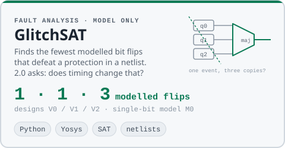
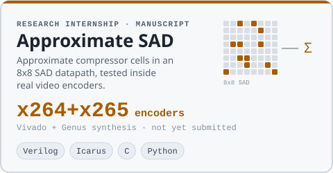
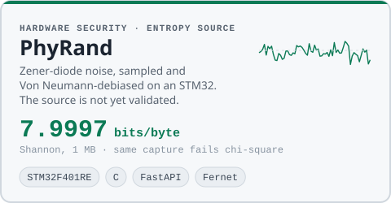
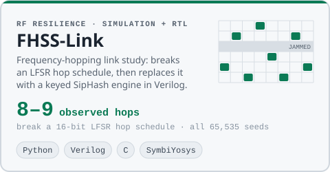
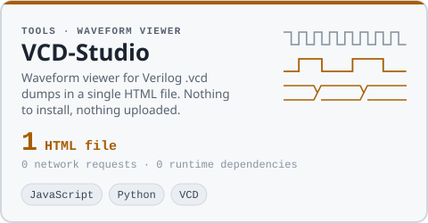

<a href="https://www.linkedin.com/in/kavinkk-vlsi-embedded">
  <picture>
    <source media="(prefers-color-scheme: dark)" srcset="assets/banner-dark.svg">
    
  </picture>
</a>

### Hi, I'm Kavin.

I'm an electronics engineer (B.Tech Electronics Engineering, VLSI, at Rashtriya Raksha University) who
works where firmware, digital logic and security meet.

**What ties the work together:** I test whether a hardware claim holds up against the real thing: a latency
claim against a logic analyzer, an error metric against real video encoders, and a redundancy countermeasure
against the physics of a glitch (that last one is work in progress).

I say what kind of result each number is. Two projects below ran on real hardware (Haptic-Sense and
PhyRand). The rest are simulation, synthesis or host-tested code, and are labelled that way. Where a number
appears, the repository says how it was produced and what has not been measured yet.

**Open to embedded firmware, RTOS, digital design and hardware-security roles.**
[Connect on LinkedIn](https://www.linkedin.com/in/kavinkk-vlsi-embedded)

## Projects

Three flagships and three supporting projects.

  <a href="https://github.com/Kavin-Re/Haptic-Sense">
    <picture>
      <source media="(prefers-color-scheme: dark)" srcset="assets/card-haptic-sense-dark.svg">
      
    </picture>
  </a>
  <a href="https://github.com/Kavin-Re/GlitchSAT-Redundancy">
    <picture>
      <source media="(prefers-color-scheme: dark)" srcset="assets/card-glitchsat-dark.svg">
      
    </picture>
  </a>

    <picture>
      <source media="(prefers-color-scheme: dark)" srcset="assets/card-sad-paper-dark.svg">
      
    </picture>
  <a href="https://github.com/Kavin-Re/PhyRand">
    <picture>
      <source media="(prefers-color-scheme: dark)" srcset="assets/card-phyrand-dark.svg">
      
    </picture>
  </a>

  <a href="https://github.com/Kavin-Re/FHSS-Link">
    <picture>
      <source media="(prefers-color-scheme: dark)" srcset="assets/card-fhss-link-dark.svg">
      
    </picture>
  </a>
  <a href="https://github.com/Kavin-Re/VCD-Studio">
    <picture>
      <source media="(prefers-color-scheme: dark)" srcset="assets/card-vcd-studio-dark.svg">
      
    </picture>
  </a>

### Flagships

| Project | In one line | Status |
|---|---|---|
| [**Haptic-Sense**](https://github.com/Kavin-Re/Haptic-Sense) | Predictive obstacle-alert prototype for visually impaired users on an STM32N6570-DK running µT-Kernel 3.0. TRON Forum Programming Contest 2026, entry 34476. | **Hardware, measured. Frozen.** Worst-case preemption latency 3.375 µs (logic analyzer) and 4.19 µs (cycle counter, 30-minute soak). These time the task handoff, not sensor-to-motor latency. Benchtop prototype, urgency feedback only, no direction. |
| [**GlitchSAT**](https://github.com/Kavin-Re/GlitchSAT-Redundancy) | Open-source fault-analysis tool for gate-level netlists: finds the smallest number of modelled bit flips that defeat a protection, checks whether a protection survived synthesis, and explains the result in a teaching app. | **Model only.** Nothing was measured on hardware. The current model flips single bits independently, so it does not cover one glitch upsetting several flip-flops, or all copies, at once. Version 2.0 asks one question: does adding timing change the verdict on one real protected block? |
| **Approximate-SAD paper** | Research internship at NIT Delhi (summer 2026), co-authored manuscript: approximate compressor cells in a shared 8x8 SAD datapath for video motion estimation, synthesised and run inside the x264 and x265 encoders. | **Simulation, synthesis and real encoders.** Not yet published. The repository stays private until publication. |

### Supporting

| Project | In one line | Status |
|---|---|---|
| [**PhyRand**](https://github.com/Kavin-Re/PhyRand) | Zener-diode noise source on an STM32F401RE with Von Neumann debiasing, a health-tested key pipeline and a file vault. | **Hardware, source unvalidated.** A 1 MB capture has 7.9997 bits/byte Shannon entropy (computed with the repository's own analysis), and the same capture fails chi-square (p = 0.0009). The control run with the diode removed has not been done. |
| [**FHSS-Link**](https://github.com/Kavin-Re/FHSS-Link) | Frequency-hopping link study: link and attacker simulators, a keyed SipHash-2-4 hop engine in Verilog, a C reference, and the HopBench schedule benchmark. | **Simulation, RTL and host C. Frozen.** An attacker model recovers a 16-bit LFSR hop schedule after 8 or 9 observed hops (exhaustive over all 65,535 seeds); the keyed schedule stays at chance against that attacker. Nothing has run on a radio. |
| [**VCD-Studio**](https://github.com/Kavin-Re/VCD-Studio) | Waveform viewer for Verilog `.vcd` dumps in one offline HTML file, plus a standard-library script for toggle counts. | **Tool. Frozen.** Works on any `.vcd` in a browser with nothing installed. GTKWave and Surfer do more. |

Every other repository on this account is frozen or archived, and its README says which and why.

## What I build

| Area | What that has meant so far |
|---|---|
| **Hardware security** | A noise source built from Zener-diode breakdown with on-chip Von Neumann debiasing; a keyed SipHash-2-4 hop engine in Verilog checked against a Python model and with SymbiYosys; a fault-analysis tool that searches netlists for the fewest modelled bit flips that defeat a protection. |
| **Real-time firmware** | A four-task µT-Kernel 3.0 application on a Cortex-M55 with preemption latency measured two ways (logic analyzer and in-firmware cycle counter); a first bare-metal STM32F4 project that parses UART telemetry onto an OLED (its SD logging never worked); C99 protocol references with no dynamic allocation, tested under sanitizers on the host. |
| **Digital design and approximate computing** | Approximate SAD datapaths for video motion estimation, synthesised and tested inside real encoders; approximate adders and multipliers as bit-accurate Python models plus Verilog, compared exhaustively in Icarus Verilog. |
| **Edge ML on MCUs** | A small INT8 model trained in Edge Impulse and run on the STM32N6 Neural-ART NPU, backed by a deterministic safety rule. |
| **Tooling** | A single-file browser waveform viewer for VCD dumps, and serial capture and analysis scripts. |

## Tech stack

<table>
  <tr><td><b>Languages</b></td><td>   </td></tr>
  <tr><td><b>MCUs &amp; boards</b></td><td> </td></tr>
  <tr><td><b>RTOS &amp; firmware</b></td><td>   </td></tr>
  <tr><td><b>RTL &amp; verification</b></td><td>    </td></tr>
  <tr><td><b>Buses &amp; peripherals</b></td><td>    </td></tr>
  <tr><td><b>Security &amp; crypto</b></td><td>    </td></tr>
  <tr><td><b>Edge ML</b></td><td>  </td></tr>
  <tr><td><b>Host side</b></td><td>    </td></tr>
</table>

## Currently

- Working on GlitchSAT 2.0: does adding timing change the verdict of a fault search on one real protected
  block? One design, one short technical note.
- Taking the co-authored approximate-SAD manuscript through to publication.
- Looking for a role in embedded systems, digital design or hardware security.

## Contact

- LinkedIn: [linkedin.com/in/kavinkk-vlsi-embedded](https://www.linkedin.com/in/kavinkk-vlsi-embedded)
- GitHub: open an issue on any repository above, and I will reply there.

<!--
Optional: live GitHub stats. These come from a third-party service (github-readme-stats), which can be
slow or rate-limited on its public instance. Remove the comment markers around this block to enable it.

  

-->

Banner and project cards are SVG files generated by <a href="tools/build_assets.py"><code>tools/build_assets.py</code></a>. No trackers, no external fonts.
